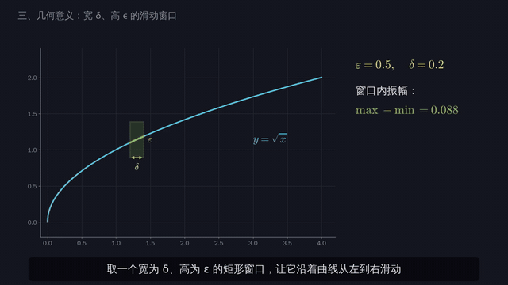
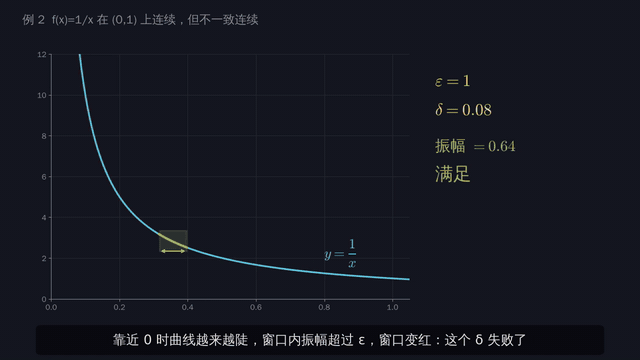
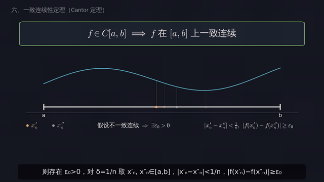
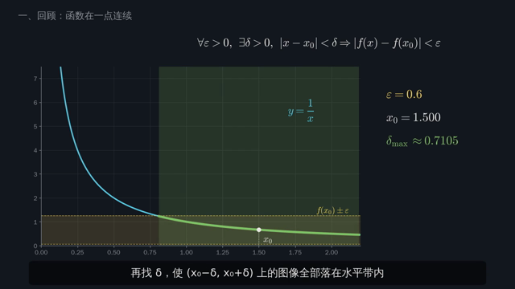
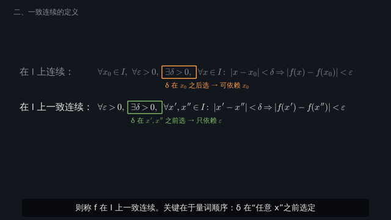
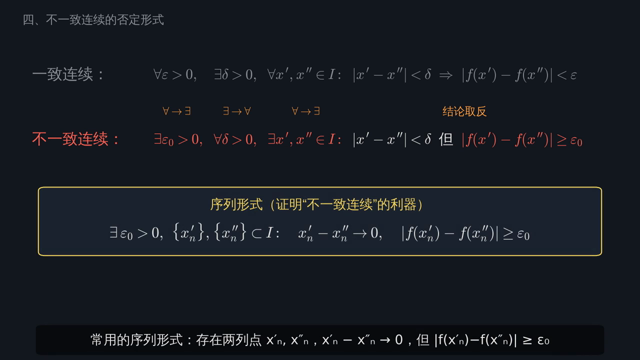
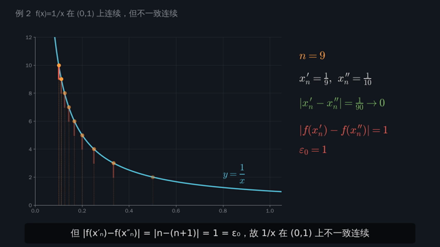
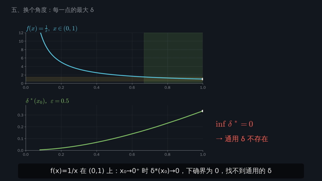
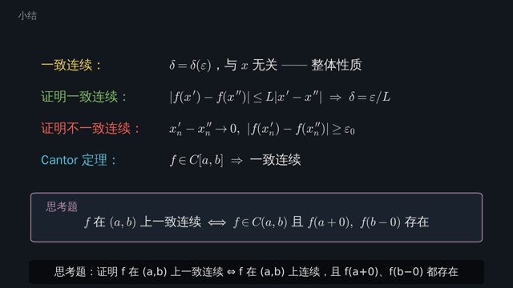

<div align="center">


# 📐 一致连续性 · 教学可视化视频

**从“逐点连续”到“整体连续”—— 用滑动窗口看懂 ε-δ**


[▶️ 观看视频](uniform_continuity/uniform_continuity.mp4) ·
[📝 字幕文件](uniform_continuity/uniform_continuity.srt) ·
[🎙️ 配音稿](uniform_continuity/narration.py) ·
[🛠️ 自己生成](#️-自己生成视频)

</div>

---

## 📖 简介

本视频配合 **华东师范大学数学科学学院《数学分析》上册 · 第四章 函数的连续性 · §2 连续函数的性质** 中的“一致连续性”一节。

视频用动画讲清楚四件事：

1. 为什么逐点连续里的 δ 会随点 x₀ 变化；
2. 一致连续的定义里，量词顺序关键在哪；
3. 怎样证明一个函数一致连续，或者不一致连续；
4. 为什么闭区间上的连续函数一定一致连续（Cantor 定理）。

> [!TIP]
> **核心直观**：取一个宽 δ、高 ε 的矩形窗口沿曲线滑动。如果曲线始终只从窗口左右两侧穿出、不碰上下两条边，那么窗口内任意两点的函数值之差都小于 ε。
> **一致连续**说的就是：对每个 ε，都能找到一个 δ，让窗口沿整条曲线畅通无阻。

## ✨ 精彩片段

<table>
<tr>
<td align="center" width="33%"><br><b>🟩 几何意义</b><br><sub>√x 在 [0,4] 上：窗口一路绿灯</sub></td>
<td align="center" width="33%"><br><b>🟥 反例</b><br><sub>1/x 在 (0,1) 上：靠近 0 处窗口变红</sub></td>
<td align="center" width="33%"><br><b>⭐ Cantor 定理</b><br><sub>点列在闭区间内收敛到 x₀</sub></td>
</tr>
</table>

## 🧭 内容目录

| # | 时间 | 章节 | 要点 |
|:-:|:-:|---|---|
| 0 | `00:00` | 🎬 片头 | 教材章节定位 |
| 1 | `00:16` | 🔁 回顾：一点处连续 | 以 1/x 为例，x₀ → 0 时可用的 δ 越来越小，说明 δ = δ(ε, x₀) |
| 2 | `01:04` | 📌 一致连续的定义 | 把两种定义的量词对齐比较，δ 在“任意 x′, x″”之前选定 |
| 3 | `01:56` | 🪟 几何意义 | 宽 δ、高 ε 的滑动窗口；√x 的导数无界，但仍一致连续 |
| 4 | `02:50` | ✏️ 例 1 sin x | 和差化积，取 δ = ε |
| 5 | `03:25` | 🔄 否定形式 | 量词 ∀ ↔ ∃ 互换；序列形式 |
| 6 | `04:06` | ❌ 例 2 1/x | 窗口在 0 附近失败；x′ₙ = 1/n，x″ₙ = 1/(n+1)；在 [r,1] 上则一致连续 |
| 7 | `05:13` | ❌ 例 3 | sin(1/x) 在 (0,1) 上；x² 在 [0,+∞) 上 |
| 8 | `05:55` | 📉 每一点的最大 δ | δ\*(x₀) 曲线；一致连续 ⇔ inf δ\* > 0 |
| 9 | `06:38` | ⭐ Cantor 定理 | 用致密性定理加反证法证明，并说明闭区间这一条件为何不可少 |
| 10 | `07:50` | 🧾 小结与思考题 | 开区间 (a,b) 上一致连续的判定 |

## 🧮 核心公式速览

**连续**（δ 可以依赖 x₀）：

$$\forall x_0\in I,\ \forall \varepsilon>0,\ \exists \delta>0,\ \forall x\in I:\ |x-x_0|<\delta \Rightarrow |f(x)-f(x_0)|<\varepsilon$$

**一致连续**（δ 只依赖 ε）：

$$\forall \varepsilon>0,\ \exists \delta>0,\ \forall x',x''\in I:\ |x'-x''|<\delta \Rightarrow |f(x')-f(x'')|<\varepsilon$$

**不一致连续的序列形式**：

$$\exists\, \varepsilon_0>0,\ \{x_n'\},\{x_n''\}\subset I:\quad x_n'-x_n''\to 0,\quad |f(x_n')-f(x_n'')|\ge\varepsilon_0$$

**Cantor 定理**：

$$f\in C[a,b]\ \Longrightarrow\ f \text{ 在 } [a,b] \text{ 上一致连续}$$

<details>
<summary>💡 <b>课后思考题</b>（点击展开）</summary>

<br>

证明：$f$ 在 $(a,b)$ 上一致连续 $\iff$ $f$ 在 $(a,b)$ 上连续，且 $f(a+0)$、$f(b-0)$ 都存在。

*提示：必要性用 Cauchy 收敛准则；充分性先把 f 延拓到 [a,b] 上，再用 Cantor 定理。*

</details>

## 🖼️ 画面一览

<table>
<tr>
<td></td>
<td></td>
<td></td>
</tr>
<tr>
<td></td>
<td></td>
<td></td>
</tr>
</table>

## 🛠️ 自己生成视频

所有画面都由代码绘制，改动后可以一键重新生成。

```bash
cd uniform_continuity

# 1) 依赖
pip install numpy matplotlib soundfile sherpa-onnx     # 另需系统自带 ffmpeg 和中文字体（文泉驿正黑）

# 2) （可选）离线合成配音：下载 Kokoro v1.1 中文模型
curl -LO https://github.com/k2-fsa/sherpa-onnx/releases/download/tts-models/kokoro-multi-lang-v1_1.tar.bz2
tar xjf kokoro-multi-lang-v1_1.tar.bz2
python3 tts.py --model-dir kokoro-multi-lang-v1_1       # 输出到 audio/

# 3) 渲染视频（多进程，4 核约 7 分钟）
python3 make_video.py                                   # → uniform_continuity.mp4 + .srt
```

| 常用参数 | 作用 |
|---|---|
| `make_video.py --preview` | 每段字幕导出一张 PNG 预览到 `preview/`，适合快速检查排版 |
| `make_video.py --scene 7` | 只渲染第 7 个场景 |
| `make_video.py --fps 60` | 修改帧率 |
| `tts.py --sid 60 --speed 1.1` | 换说话人（共 103 个）或语速 |

> [!NOTE]
> 没有 `audio/` 目录时，`make_video.py` 会输出无配音版本，各段使用预设时长。
> 有配音时，每段画面会按配音长度自动拉伸，动画节奏与讲解保持同步。

## 📂 项目结构

```text
math1/
├── README.md
└── uniform_continuity/
    ├── make_video.py           # 🎞️ 场景动画与渲染管线（matplotlib → ffmpeg）
    ├── narration.py            # 🎙️ 配音稿：与字幕一一对应的口语读法
    ├── tts.py                  # 🔊 离线语音合成（sherpa-onnx + Kokoro）
    ├── uniform_continuity.mp4  # ▶️ 成片
    ├── uniform_continuity.srt  # 📝 字幕
    └── docs/                   # 🖼️ README 用的截图和动图
```

## 🔧 技术说明

- **动画**：每个场景都是一个 `Scene` 子类，字幕段的起始时刻作为动画锚点。各场景并行渲染，再用 ffmpeg 拼接。
- **公式**：使用 matplotlib mathtext（Computer Modern 字体），中文使用文泉驿正黑。
- **配音**：用 [sherpa-onnx](https://github.com/k2-fsa/sherpa-onnx) 加 Kokoro v1.1-zh 模型在本地合成，不依赖在线服务。成片的配音已用离线语音识别（Paraformer）逐段转写校对，并抽查了音画同步。
- **反例中的“窗口变红”**：程序实时计算窗口内函数值的最大值减最小值，与 ε 比较后决定窗口颜色，不是手工设定的。

## 📚 参考

- 华东师范大学数学科学学院．《数学分析》（上册），第四章 §2 连续函数的性质．高等教育出版社．

<div align="center">
<sub>Made with ❤️, matplotlib & ffmpeg · 如果对你有帮助，欢迎点个 ⭐</sub>
</div>
